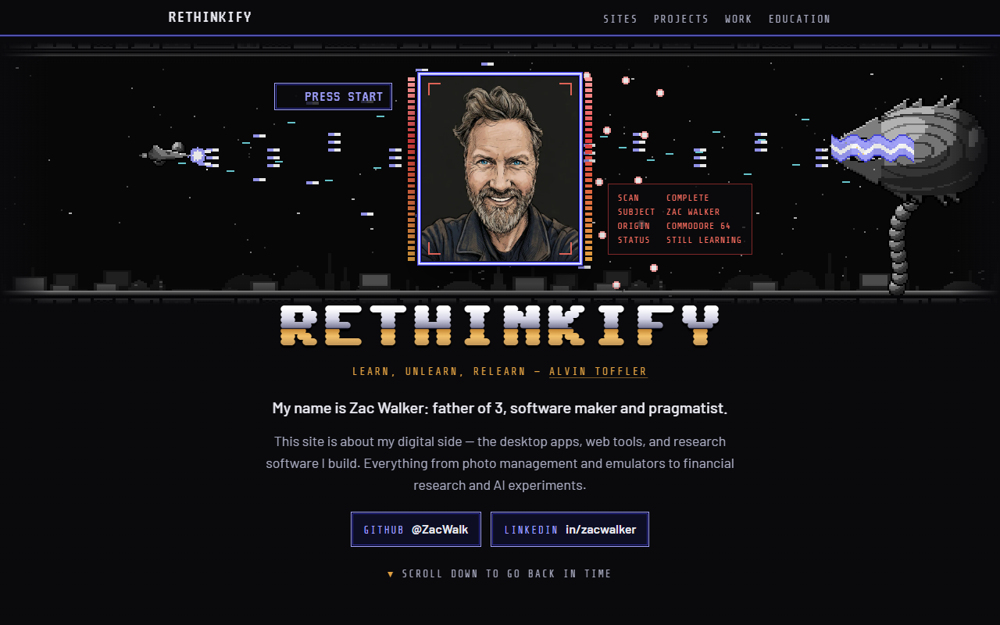

# About zacwalk.com

Personal site of Zac Walker — a single page covering his sites, open-source projects,
professional work and education. It opens on an 80s title screen, the attract mode of an
R-Type-style shooter drawn in C64 pixels: the real game plays itself in grey behind the portrait,
and scrolling takes you back in time to a Commodore 64 `READY.` prompt. Press start on the title
screen and it is your game.

Canonical site: [zacwalk.com](https://zacwalk.com).



The Google Cloud project is **ZacWalk**, ID `zacwalk`. The local folder remains
`rethinkify`; the upstream is [ZacWalk/zacwalk](https://github.com/ZacWalk/zacwalk).
Keep `rethinkify.com` and both domains' `www` mappings/DNS active: legacy and
`www` page URLs permanently redirect to the same path and query on `zacwalk.com`.
The old `rethinkify` Google project is retained for rollback, not deployment.

## Stack

A small Flask app on Google App Engine (Python 3.13 standard environment), served by
gunicorn. Server-rendered Jinja2 and hand-written CSS. The compact menu and the title screen's
game use plain JavaScript with no build step; the
`Content-Security-Policy` in `web/main.py` allows scripts from this origin only.

## Layout

```
web/
├── app.yaml           # App Engine config: runtime, scaling, static handlers
├── main.py            # Routes, security headers, asset versioning
├── requirements.txt
├── static/
│   ├── zacwalk-portrait.svg
│   ├── game/          # The game: boot.js, the attract mode and its pilot, the cabinet, the game,
│   │                  # its art, stages and sound chip
│   ├── images/
│   └── styles.css
└── templates/
    ├── index.html     # The page
    ├── error.html     # 404 / 500, as C64 error screens
    └── sitemap.xml
```

## Project layout

Projects are told as five short stories, one per interest (photos, AI, markets, compilers and
Win32 apps), in the spirit of [bellard.org](https://bellard.org/): plain first-person paragraphs
with the achievements linked inline, whether they are my repos or work in other projects such
as GCC and Electron. Each story has one picture, which sits beside it and keeps pace as you
read; on phones it sits above.

Descriptions follow the linked public GitHub READMEs, including the Rust projects
nncpu, trade-rl and trade-db. Only public repositories are linked.
The Alpha Galactica and 64Ready cards use local copies of their original SVG logos;
project pictures come from the public repos' screenshots. Use a new filename when replacing
an image, because App Engine caches pictures for 30 days.

## The game

A sideways-scrolling shoot-'em-up in the spirit of R-Type, with every picture, stage and sound
effect made by code. Its five stages run back in time like the page, from The Cloud to the
Commodore 64, each with a boss named after a bug of its era. An IBM PC, a Commodore 64 and a
ZX81 stand on the floor of every stage, and chrome endoskeletons in the style of Terminator 2
march along it. Its soundtrack, a tune for each stage and a boss theme, was written for it and
its C64 version with turbo-sid; an AudioWorklet plays it on an emulated 6502 and SID.

Arrow keys or WASD fly, holding space fires and charges the beam, letting go fires it. P pauses,
M mutes, F goes full screen and Escape quits. A gamepad works, and on a touch screen you drag to
fly and let go to fire the beam.

Until someone presses start, the game plays itself behind the portrait, in grey so it never
competes with the face, with only its shots and explosions in colour. Its screen widens to fill
the window, up to three times the arcade's, so the game plays out on both sides of the portrait.
The stages are the same every time, but the pilot is not: it looks a short way ahead along every
way it could steer, dodges what it sees coming, and takes on a different style each game, so no
two demos play out alike. **Pause demo** freezes the background; **Press start**
still opens the game. Reduced motion shows a still frame, and scrolling away
stops the demo.

Scores remain browser-local under the compatible `rethinkify-scores` key.
Browser storage is origin-specific, so old-domain scores do not automatically
transfer to `zacwalk.com`.

## Routes

| Route | Purpose |
| --- | --- |
| `/` | The page |
| `/about` | 301 to `/#about`, the CV section |
| `/health` | `ok` (200) for uptime checks |
| `/robots.txt` | Generated, points at the sitemap |
| `/sitemap.xml` | Generated |
| `/favicon.ico` | Serves `static/zacwalk-portrait.svg` |
| `/game/<version>/<file>.js` | The game's modules, only under the current version token |

## Developing

Run these commands from the repository root.

```powershell
.\dd.ps1 run              # http://localhost:8081
.\dd.ps1 format           # Black, on web/
.\dd.ps1 format --check   # Black, no writes
```

`run` uses `.venv` if present; otherwise create one and
`pip install -r web/requirements.txt`.

Check the page's project links, images, anchors and routes without network access:

```powershell
.\.venv\Scripts\python -m unittest discover -s test
```

The project-link test records the public repository names verified for the page. Check
GitHub visibility and the README before adding a name or changing a description.

The favicon is the vector portrait in `web/static/zacwalk-portrait.svg`. The other
sites use the same SVG on their ZacWalk card; run `..\tools\sync_site_cards.ps1`
from this folder after changing it. Bump the portrait URL's `v` in the home and
error pages and in the shared card template when replacing the artwork.

## Deploying

```powershell
.\dd.ps1 deploy
```

Ships to the `zacwalk` App Engine project in `europe-west1`. The target project is
hard-pinned in `dd.ps1` so a misconfigured `gcloud config` cannot deploy elsewhere.
